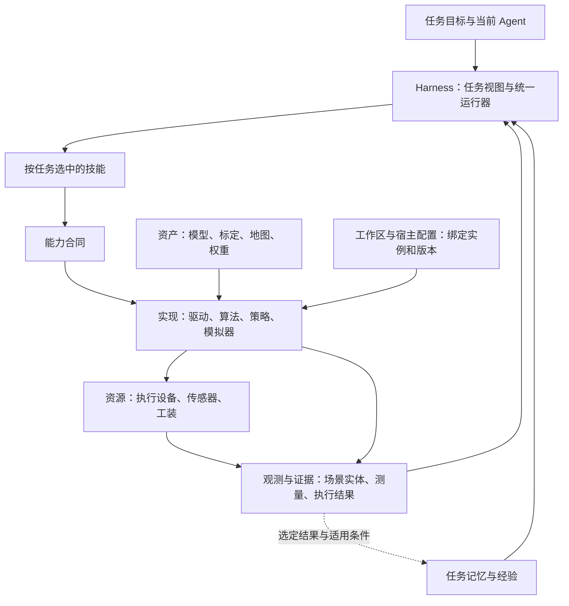

# Robot RSI Harness

面向机器人任务的 Agent 运行框架。让 Agent 按任务发现技能、调用已验证代码、读取必要观测，在能力不足时请求模型或人工援助，并将有效经验用于下一版技能。

设备和算法通过能力接口接入；宿主配置绑定实例、模型、标定与部署位置。当前支持 mock 任务、记忆、技能生命周期、Agent 会话、标准适配工厂与版本化数据。接入 Agent 可按[项目样例](examples/project_adapter/README.md)从已有源码整理可安装能力；运行 Agent 通过类型化工具选择、试用和保存相机/运动学绑定，后续任务固定版本并跨重启复用。本站验证限 authored synthetic/mock；产品内原生 Agent 自主绑定和真实设备另行实测，不宣称任意项目自动理解。

## 快速开始

需要 Python 3.12 或 3.13，以及 uv。在源码目录执行：

```bash
uv sync --frozen --group dev
uv run --frozen robot-rsi --profile configs/demo.json config-check
uv run --frozen robot-rsi --profile configs/demo.json demo
```

`demo` 执行模拟抓放与结果验证，不调用模型或连接机器人；重复运行会重置模拟场景，保留该工作区的历史记录。

已有 Agent 可通过 MCP 使用工具：

```bash
uv run --frozen robot-rsi --profile configs/demo.json mcp
```

也可使用自带任务入口。它使用当前已登录的 Codex 客户端和模型配置，会产生模型调用：

```bash
uv run --frozen robot-rsi --profile configs/demo.json agent run --task-id demo-agent "将红色积木放进蓝色盒子，确认结果"
uv run --frozen robot-rsi --profile configs/demo.json agent status --task-id demo-agent
```

已知完整目标可直接使用代码配方，无需模型回合：

```bash
uv run --frozen robot-rsi --profile configs/demo.json agent recipe --task-id demo-recipe --parameters '{"object_id":"red_block","target_region":"blue_box"}'
```

## 怎样组织任务



- 工作区保存可用资源与技能；每个任务只读取必要技能描述、当前状态和适用经验。
- 常规动作优先代码技能。模型处理计划选择或能力缺口；操作等待由宿主承担。
- 同一任务内复用会话并传递变化；短记忆按有效变化整理，重复信息合并，完成过程归档。token 仅观测。
- 操作成功与整个任务完成分别记录。恢复读取检查点，不重放物理动作。

图表示职责关系，具体可用能力由安装版本与工作区决定。设备控制和高频传感留在宿主通道，Agent 主要接收需要决策的变化与结果。

## 对象如何分类

| 对象 | 放在哪里 |
|---|---|
| 机械臂、底盘、夹爪、相机、力传感器、可控工装 | 设备资源；按实际能力绑定，可共享 owner |
| 零件、容器、障碍和目标区域 | 场景实体；位置与状态来自观测 |
| 几何模型、标定、地图、模型权重 | 版本化资产；供实现和任务引用 |
| 观测、定位、FK/IK、规划、执行、验证 | 能力合同；由具体驱动或算法实现 |
| 抓放、巡检、标定采样、任务记忆、接入方法 | 技能；按当前目标检索与使用 |
| 图像、轨迹、回执、验证结果、适用经验 | 证据与记忆；原始证据和提炼经验分别保存 |

包负责分发实现、技能与数据，工具是 Agent 的调用入口。分类不要求每一项都建模块，也不代表上表列出的设备或算法都已支持。接口与扩展位置见[对象与能力接口](docs/interfaces.md)。

## 技能分工

| 用途 | 技能或入口 | 使用者 |
|---|---|---|
| 工作区资料 | [workspace_context](src/robot_rsi/resources/workspace-context/SKILL.md) | 运行 Agent 按需读取资料和更新备注 |
| 任务记忆 | [task_memory](src/robot_rsi/resources/task-memory/SKILL.md) | 运行 Agent 保存检查点、恢复与归档 |
| 任务执行 | pick_place 代码技能；pick_place_v1 完整目标配方 | 运行器执行，按证据判断结果 |
| 经验与评估 | experience / evaluation / release 宿主 CLI | 独立评估身份，选择候选版本 |
| 资源接入 | [robot-onboarding](skills/robot-onboarding/SKILL.md) | 接入方 Agent 分类对象并编写适配包；不默认载入日常任务 |

技能另用适用范围区分通用、任务领域和现场专属方法；代码/工作流是执行形式，集成/运行/离线评估是使用阶段。驱动、FK/IK、深度和标定求解器是能力实现；需要安排多步骤方法时，才编写相应工作流技能。

查看当前工作区与技能：

```bash
uv run --frozen robot-rsi --profile configs/demo.json call workspace_read
uv run --frozen robot-rsi --profile configs/demo.json call skills_list '{"query":"抓放"}'
uv run --frozen robot-rsi --profile configs/demo.json call skill_describe '{"name":"pick_place"}'
```

技能包支持创建、注册、启用、更新和移除；`robot-rsi skill --help` 查看入口。更新产生新版本，运行中的任务保留既有版本，说明正文按需加载。

## 机器人、相机与算法接入

机器人与相机是并列资源，可以共用已有设备管理器；末端相机的安装关系用坐标系和标定表示。FK/IK 属于计算能力。相机标定的工作流、求解算法和版本化参数分别管理，普通任务读取适用参数。

- [公共资源接口](docs/interfaces.md)：能力划分、数据语义与当前支持范围。
- [接入指南](docs/integration.md)：接入顺序、基础技能与安装示例。
- [非抓放流程示例：面板巡检](docs/task-walkthrough.md)：选技、绑定、上下文、结果与援助的完整设计走查；该示例技能尚未实现。

当前深度路径包含 Fast Foundation Stereo 适配，使用校正双目输入；模型环境、真实相机输入和设备性能需另行验证。SDK 或算法包接通，也不自动意味着已有定位、规划和抓放验证能力。

接入也可从已有项目开始：接入 Agent 梳理源码与证据，交付可安装能力；运行 Agent 用现有工具选择、验证和保存相机/运动学绑定，后续任务按固定引用复用。见[项目接入与完整任务示例](examples/project_adapter/README.md)。源码分析留接入侧；自建夹具不代表任意项目自动适配，产品内原生 Agent 自主绑定和真实现场仍未验。

外部样例的实际安装/工厂/profile/API 见 [接入指南](docs/integration.md)与 [独立适配包](examples/synthetic_adapter/README.md)。它演练非左右臂命名、独立相机和无机器人计算，全部是 synthetic；不提供真实 SDK 或通用规划/求解器。

## 数据与发行

运行状态默认保存在用户数据目录，按角色、站点和工作区分开。开发、运行和独立评估通过选定证据与版本化产物交换信息，任务上下文不加载整个历史库。

构建安装包可运行 `uv build --wheel`，再在独立环境安装生成的 wheel。运行配置与状态目录单独保留，安装新版本后在任务边界重启；未决操作不重放。

## 本地检查

```bash
uv pip install --no-deps -e examples/synthetic_adapter
uv run --no-sync pytest -q
uv run --no-sync ruff check src tests examples
uv build --wheel
```

mock 与协议样例说明软件路径的行为；真实机器人、实际模型效果与现场性能分别记录。
