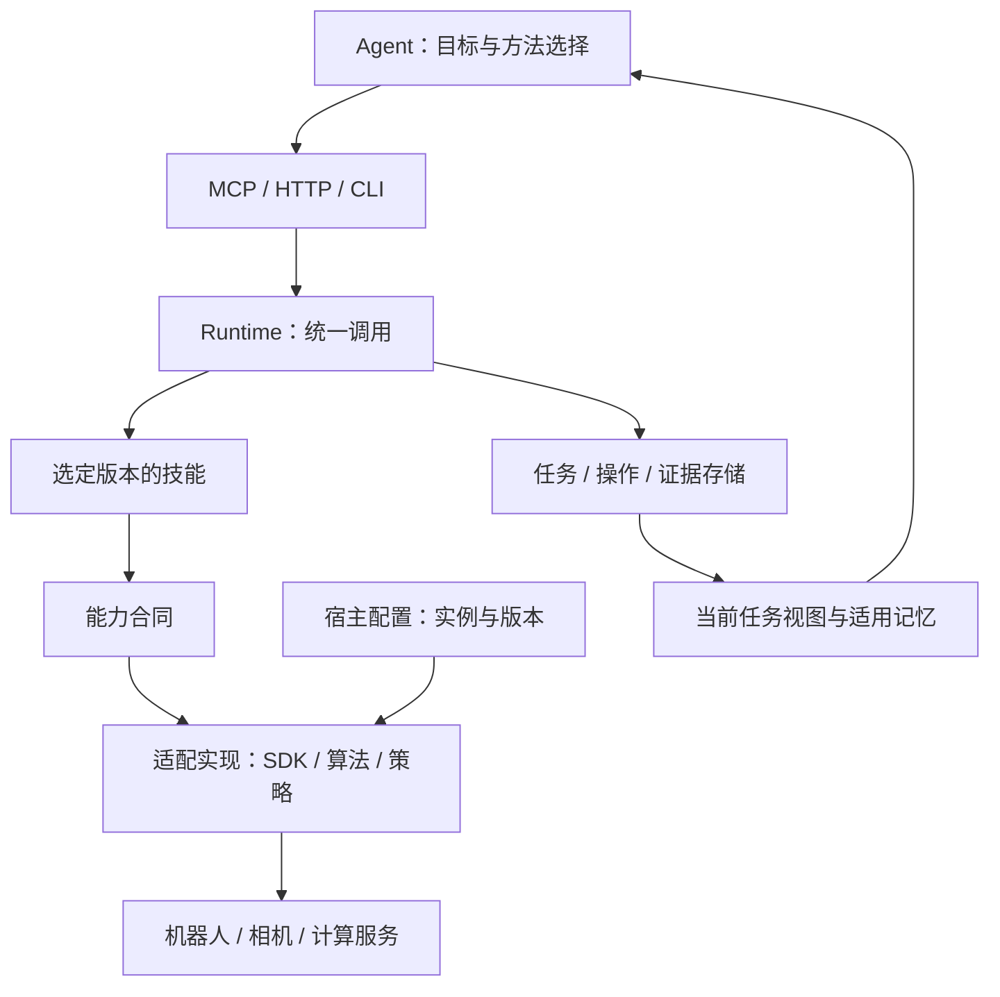

# 项目架构与代码导航

Robot RSI Harness 是连接通用 Agent 与机器人能力的运行框架。它组织任务、调用和记录；使用方项目提供具体设备、算法与任务方法。

本文说明公共结构和源码入口。精确输入输出以安装版本的工具 schema 与 Python 合同为准，接入步骤见[接入指南](integration.md)。

## 项目与包的命名

| 名称 | 含义 |
|---|---|
| `Robot RSI Harness` | 项目名称；RSI 沿用项目的持续改进方向 |
| `robot-rsi-harness` | Python 安装发行名，在 pyproject.toml 中定义 |
| `robot_rsi` | Python 根导入包，例如 `from robot_rsi.runtime import Runtime` |
| `robot-rsi` | 命令行入口，指向 `robot_rsi.cli:main` |

根导入包承载整个框架实现。相机、任务、记忆和技能管理等是其中的不同模块；技能与适配扩展可作为自己的包安装。

## 框架与使用方项目

| 框架提供 | 使用方项目提供 |
|---|---|
| 公共能力合同、统一工具入口与运行器 | 机器人 SDK、已有控制程序、相机和算法实现 |
| 技能发现、注册、固定版本与调用 | 任务技能及其输入、输出和完成条件 |
| 任务进度、操作结果、证据和记忆机制 | 任务目标、现场事实及适用经验 |
| 适配工厂和宿主配置格式 | 设备实例、连接信息、模型与标定版本 |

机器人项目可以同时保存接入代码、技能、资料和任务记录。Agent 按当前工作读取需要的内容；框架自身的研发记录不属于使用方的默认上下文。

## 调用关系

Agent 提交任务或工具调用。Runtime 解析参数及当前绑定，技能通过能力接口调用实现；操作管理记录执行过程与结果。任务视图将当前需要的信息交回 Agent，原始图像和日志通过引用读取。

## 四层如何扩展

| 层 | 回答的问题 | 扩展方式 |
|---|---|---|
| 技能 | 怎样组合能力完成一个任务？ | 增加带描述、入口、参数和结果合同的技能包 |
| 能力合同 | 某种操作需要什么输入，返回什么结果？ | 优先采用已有端口；公共语义缺失时由框架维护方完善合同 |
| 适配实现 | 怎样调用具体 SDK 或算法？ | 编写可安装适配包，保留原设备执行 owner |
| 宿主装配 | 本项目使用哪个实例、实现和版本？ | 用 profile 组合端口、资源、模型和标定 |

机器人与相机是并列的设备资源。FK/IK、深度和标定求解器提供计算能力；模型、权重、标定参数是有版本的资产。多个步骤构成可复用方法时，再组织为技能。

## 代码导航

当前采用一个 Python 根包组织模块。下表是实际职责导航，不表示已经拆成多个独立服务。

| 职责 | 主要源码入口 | 负责的事情 |
|---|---|---|
| 工具与进程入口 | [cli.py](../src/robot_rsi/cli.py)、[mcp_server.py](../src/robot_rsi/mcp_server.py)、[server.py](../src/robot_rsi/server.py) | CLI、MCP 和 HTTP 的协议入口 |
| 统一调用与宿主装配 | [runtime.py](../src/robot_rsi/runtime.py)、[host.py](../src/robot_rsi/host.py)、[adapters.py](../src/robot_rsi/adapters.py) | 工具分发、构造端口、资源生命周期和扩展工厂 |
| 公共合同与能力绑定 | [contracts.py](../src/robot_rsi/contracts.py)、[capabilities.py](../src/robot_rsi/capabilities.py)、[resources.py](../src/robot_rsi/resources.py)、[scene_bindings.py](../src/robot_rsi/scene_bindings.py) | 参数和数据模型、能力组合、资源/运动学/标定、场景选择与固定引用 |
| 操作与任务记录 | [operations.py](../src/robot_rsi/operations.py)、[task_memory.py](../src/robot_rsi/task_memory.py)、[task_snapshot.py](../src/robot_rsi/task_snapshot.py) | 操作生命周期、任务检查点、整体结果、归档和快照 |
| Agent 会话与上下文 | [agent_host.py](../src/robot_rsi/agent_host.py)、[agent_client.py](../src/robot_rsi/agent_client.py)、[agent_state.py](../src/robot_rsi/agent_state.py)、[task_context.py](../src/robot_rsi/task_context.py) | 客户端连接、会话接续、援助材料和必要信息装配 |
| 工作区、记忆和证据 | [workspace.py](../src/robot_rsi/workspace.py)、[memory.py](../src/robot_rsi/memory.py)、[storage.py](../src/robot_rsi/storage.py)、[evidence.py](../src/robot_rsi/evidence.py) | 工作区资料、适用经验、作用域存储和证据导出 |
| 技能与版本管理 | [registry.py](../src/robot_rsi/registry.py)、[skill_management.py](../src/robot_rsi/skill_management.py)、[catalog.py](../src/robot_rsi/catalog.py)、[experience.py](../src/robot_rsi/experience.py)、[installation.py](../src/robot_rsi/installation.py) | 技能目录、包注册/启用、候选评估关联、发布/回退和安装身份 |
| 感知与内置实现 | [perception.py](../src/robot_rsi/perception.py)、[cameras.py](../src/robot_rsi/cameras.py)、[depth.py](../src/robot_rsi/depth.py)、[depth_backends.py](../src/robot_rsi/depth_backends.py)、[robots.py](../src/robot_rsi/robots.py) | 相机/深度合同和实现、内置设备路径；具体后端可由外部适配包提供 |

`resources.py` 保存资源与计算合同；同名的 `resources/` 目录保存随包分发的技能文件。`skills.py`、`skill_models.py`、`recipe.py` 当前主要承载内置抓放参考任务；`pick_place` 意为抓取并放置，是具体任务技能。技能管理和统一运行由上表对应模块承担，接入新任务时使用扩展入口。

这些参考实现帮助验证框架调用链。具体任务逻辑、模拟夹具与通用机制应保持清楚的边界；源码导航反映当前文件职责，不将某个参考任务当作所有机器人任务的定义。

## 技能、接口与安装包

- `skills/robot-onboarding/SKILL.md` 指导接入方 Agent 理解已有软件并生成适配产物。
- `src/robot_rsi/resources/workspace-context/` 和 `task-memory/` 提供工作区资料、任务记忆的基础说明。
- `robot_rsi.adapters` 是适配工厂的 Python entry point 分组；`robot_rsi.skills` 用于发现安装包提供的技能。
- 能力和技能的可用性来自实际安装与工作区绑定。发布说明、源文件存在或历史成功记录都不自动代表当前设备可用。

当前发行支持相机/运动学候选的选择、校验、保存和重启复用。其他资源仍可由适配工厂装配，具体工具与支持范围查阅[公共接口](interfaces.md)。

## 任务、记忆与更新

一次用户目标对应任务；一次技能执行或异步调用对应操作。操作成功后，Agent 还需要按任务条件判断整个目标并保存结果。等待、取消和状态查询由宿主通道处理。

技能目录先提供简短描述，选中后读取完整说明。任务固定技能、能力及所需资产的版本；记忆保留来源和适用条件，当前设备状态从观测获取。长期记录可以累积，当前上下文只读取所需部分。

本地实现可在用户项目中改进，形成候选后进行相应验证，再在任务边界启用固定版本。框架维护方负责公共接口和共同机制，使用方负责具体算法、任务方法及现场适配。

## 文档分工

- [README](../README.md)：框架用途、开始使用和主要入口。
- [本架构说明](architecture.md)：职责关系与源码导航。
- [接入指南](integration.md)：已有项目、SDK 和算法怎样接到框架。
- [接口参考](interfaces.md)：能力分类、调用语义和精确 schema 的源码位置。
- [文档目录](README.md)：按使用目的查找说明与参考案例。
