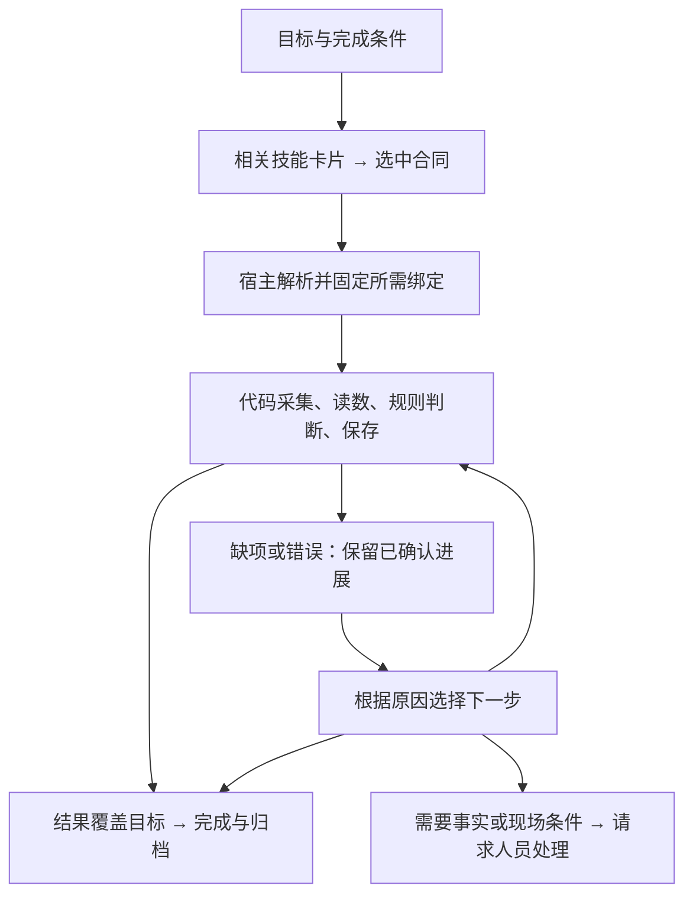

# 流程示例：设备面板巡检

这是上层设计走查，尚未实现或运行该巡检技能。`inspect_panel`、`panel.read_indicators` 和以下面板/相机标识均为示例。已有任务、目录、相机、操作与记忆机制可复用；领域识别能力及通用失败路由仍有待实现部分。

## 任务与完成条件

用户目标：“读取 P1 面板的运行、报警、通信三个指示灯，按该面板规则生成带图巡检记录。读不清的明确注明，只观察。”

示例只检查本次观测中的灯态。工作区已提供 P1 的面板规格：目标标识、灯位/标签、支持的状态及正常组合。规格是版本化资产，不把每块面板写成不同技能，也不由模型临时猜测颜色含义。

完成条件是覆盖三个检查项并保存证据与结论。结果可以是正常、异常或无法判断；无法判断项说明原因。发现报警灯亮仍可能成功完成巡检。若用户要求“必须确认设备正常”，这是更强的目标：无法判断不能满足它；也不能因一次步骤成功而结束整个任务。

## 最小组合

| 对象 | 本例绑定 | 用途 |
|---|---|---|
| 场景实体 | P1 面板与三个指示灯 | 被检查的对象 |
| 数据资产 | P1 面板规格与规则的选定版本 | 确定检查项、位置和结果含义 |
| 代码技能 | `inspect_panel@1`（示例） | 采集→读数→应用规则→保存报告 |
| 能力 | `camera.capture@1`；`panel.read_indicators@1`（后者为示例） | 获取观测；从观测与规格得到各项灯态及可读性 |
| 实现 | 固定相机适配器；面板读数 provider | 分别完成采集和识别 |
| 既有基础 | 任务/操作、artifact、检查点与经验 | 保存本次进展和结果，按需接续 |

首版方法保持一个技能、两个语义能力和一份面板规格。规则比较与报告整理是技能内的普通代码；保存产物复用已有存储，不拆成新的 Agent、验证服务或报告技能。二维读灯不依赖深度、FK/IK、机器人模型或机械臂执行权；只带当前识别方法实际需要的图像条件。

## 1. 如何选技能

1. Harness 建立或恢复任务，保存目标、三个检查项、允许输出不确定项及只读约束。工作区资料足够时直接复用。
2. Agent 用任务关键词检索目录；Harness 先按工作区启用版本和能力条件过滤，返回相关短卡片。
3. 若目录有 `inspect_panel`、`read_text`、`capture_image`，优先选择覆盖整个巡检结果的 `inspect_panel`。后两者只能提供部分材料，不能因为名称相近就宣称任务完成。
4. 读取选中技能的输入、结果、适用范围与所需能力。普通参数只需面板引用；相机地址、模型路径和阈值不由 Agent 重填。

没有完整技能时，只有已声明的工具/工作流能覆盖目标才组合使用；否则报告具体缺口。可以提出离线补技能的候选，不在当前任务里安装模型或改核心代码。

## 2. 如何绑定能力

首次进入场景时，Agent 先读宿主提供的候选相机、读数实现和规格资料，按需看图，提出能覆盖 P1 检查项的组合。Harness 核对合同与适用条件，执行必要试读并保存结果。后续任务复用已验证组合。以下是最终关系示意，不是可直接复制的配置 schema；自动绑定闭环仍待实现：

```text
inspection_view → camera_front → CameraPort.capture
panel_reading   → indicator_reader → panel.read_indicators
P1             → panel_spec@3（检查项与规则）
inspect_panel@1 → 上述两项能力和 P1 规格
```

Agent 决定选择，运行器解析所需角色/合同到具体 provider，校验后记录场景绑定及任务所用版本。相机返回带时间和来源的帧引用；读数 provider 消费这个引用和面板规格，不自行寻找另一台相机。技能只使用这些合同。

静态绑定在装配/相关版本变化时核对；执行时只检查本次采集与识别需要的就绪、图像新鲜度和适用条件，不遍历所有设备。新鲜度范围由任务/方法规定，不伪造统一阈值。

多台相机时，先复用已有适用绑定；没有时 Agent 根据描述与必要图像选择 inspection_view，再验证保存。仍有歧义则返回具体缺项供补充信息。profile 限定候选与宿主装配，场景选择不要求始终由人预写。运行中失联保留原绑定和失败证据，在明确的任务边界才使用新绑定，不静默替换未决操作的 provider。

换成另一厂家相机，适配器继续提供相同观测合同即可；不同面板布局用另一份规格资产。所需能力本身缺失则明确不可执行，不靠一个空端口通过筛选。

## 3. 上下文怎样变化

| 决策时机 | 模型收到什么 | 留在宿主/存储中的内容 |
|---|---|---|
| 初次选技 | 目标、只读约束、P1 简介、相关技能/能力短卡片 | 完整技能库、其他设备、SDK、模型权重、历史报告 |
| 选择后 | `inspect_panel` 合同、P1 规则摘要/版本、已有绑定；若缺失则所需候选与验证结果 | 全部配置和源代码；技能直接读取所需资产 |
| 代码执行中 | 通常无需新模型回合；宿主等待结果 | 图像采集、读数、规则比较和报告保存 |
| 需要援助 | 当前缺项、失败原因、已尝试方法、允许下一步、相关图片/裁剪引用 | 无关成功记录、其余技能说明和其他相机流 |
| 收尾 | 三项结果、正常/异常/无法判断、报告与观测引用 | 原图、完整识别输出及过程日志 |

复用既有任务视图和变化块；不为这个任务再加上下文管理器。图片在需要视觉判断且当前角色支持图像输入时按引用读取；文字摘要不能冒充已经看过图片。记忆保存采用有效变化维护，不要求每个代码阶段调用一次记忆技能。

## 4. 一次正常执行

1. Agent 选定技能并提交任务参数。相机连接由已配置宿主生命周期负责，目录发现本身不连接设备。
2. 代码获取新观测 O1，读数 provider 返回：运行灯亮、报警灯灭、通信灯亮，连同逐项来源与可读性。
3. 技能根据 P1 规则得到“正常”，保存报告 R1。三个检查项和图像来源都在报告中。
4. 操作返回“已生成报告”与引用。宿主已有等待机制将结果送回当前任务；Agent 核对它覆盖原目标后，使用既有完成入口收尾。无需再请老师复核一遍。

本例是自然语言任务走查；尚未新增对应完整目标配方。将来只有入口明确绑定整个巡检目标与完成判据时，才可像已有显式配方一样由宿主自动收尾。



从缺项进入完成只适用于原目标允许“无法判断”报告且报告已交付的情况，不能绕过未完成检查项或未知动作。

## 5. 出问题后由谁处理

| 情况 | 下一步 | 何时结束或求助 |
|---|---|---|
| 报警灯确实亮 | 代码如实记录“异常”，保留图像 | 巡检目标已完成；不为追求“正常”反复拍摄 |
| 一次采集超时或画面短暂模糊 | 技能使用发布时声明的局部只读恢复，例如再采一帧 | 时间/恢复条件内执行；一次是本例取值，不是框架统一配额。新帧保留新时间 |
| 反光导致一项无法读取 | 若目标允许，生成带缺项的报告；需要确定结论时才请求决策 | 不把无法读取标成硬件动作效果未知，也不默认升级所有模型 |
| 有现成读图/裁剪工具，但需要判断哪种观察有用 | 小模型读取最小援助材料，选择已有方法 | 只有获得新证据或执行不同有效方法才继续，不能对同一失败无变化重试 |
| 需要复杂解释，且配置的大模型具备相关输入与工具能力 | 大模型接收同一任务的必要证据和允许操作 | 可给有来源的辅助读数/下一步；保留模型援助标记，不改规则或在线改技能版本 |
| 缺面板规则、设备断电、遮挡需现场清理 | 直接请求提供事实或处理现场的人 | 不先走小模型→大模型的固定阶梯；更强模型不能补不存在的事实/硬件 |
| 宿主中断、报告保存结果不明 | 先按原操作/产物引用查已保存结果，保留确认过的阶段 | 未确认交付不标完成；需要重新计算或采集时作为明确新操作，历史日志不自动重放 |

技能级已知恢复由代码处理；模型只处理尚需选择的问题。取消则结束本次采集/计算并保留已有材料；此只读任务不请求机械臂 HOLD，也不占用机械臂控制权。

若之后任务增加“按按钮复位”等物理动作，应另有明确动作目标、能力与结果判据。发生未确认物理效果时沿用原控制语义，不能借巡检的只读恢复规则重发动作。

## 6. 三种结果分别表达

| 要回答的问题 | 示例 |
|---|---|
| 操作是否执行并交付产物 | 报告已保存；采集失败；运行中断且结果未确认 |
| 业务检查得到什么结论 | 正常；异常；因反光无法判断 |
| 用户的整个目标是否达成 | 带缺项报告符合本次目标；或要求确定结论但证据仍不足 |

“报警灯亮”与“没有读清报警灯”写在领域结果中，不能复用抓放专用的 failed/verification_unknown 来表达。领域不确定性如实进入报告和任务摘要；只有确实阻碍当前目标时才成为未解决任务项。这个区分不允许隐藏未知效果，或放宽原完成条件。

## 7. 经验与下一版

任务归档只保留可恢复的简短结论与证据引用。一次反光记录首先是证据；重复出现且适用范围清楚后，才形成“这一面板/相机条件下某种裁剪更可读”的经验候选。设备/规则映射仍属于配置或资产。

若确需改进识别方法或恢复流程，离线修改候选版本，使用独立正常、异常、模糊、缺项样例比较，合格后供新任务选择。在途任务不热改；使用模型援助获得的结果与独立代码结果分别记录。

## 本例带来的简化

- 一个任务技能组织常规流程；能力、规则计算、报告存储各归原职责，不逐步增加模型或技能。
- Agent 在首次或条件变化时选择并验证场景组合；宿主解析和保存，后续直接复用，仅对所需资源检查当次条件。
- 明确只读任务的局部恢复与领域结果，按实际缺口求助；不把所有不确定性都升级为人工接管。
- 完成判据围绕用户目标，允许可靠报告发现异常；保留已有任务/操作/证据状态，不新增状态机。
